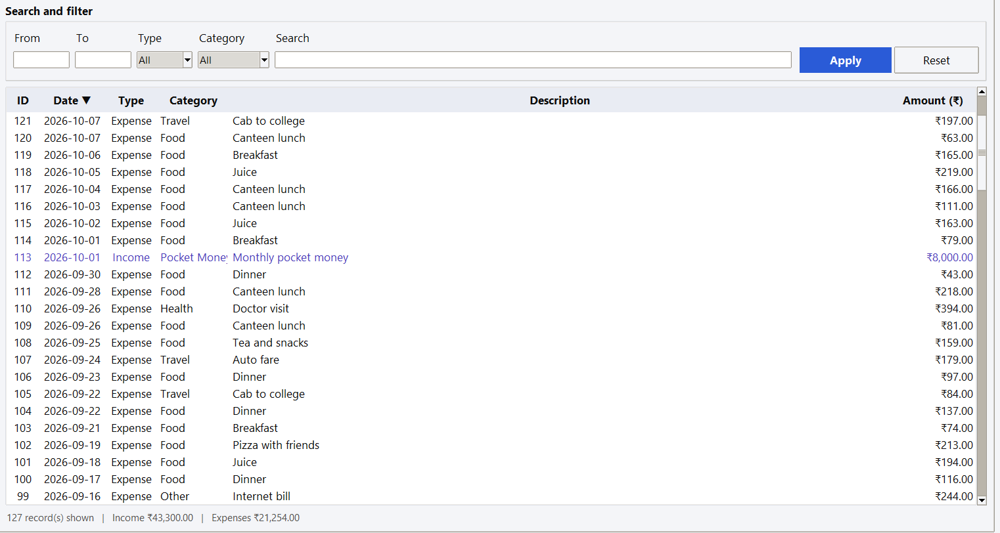
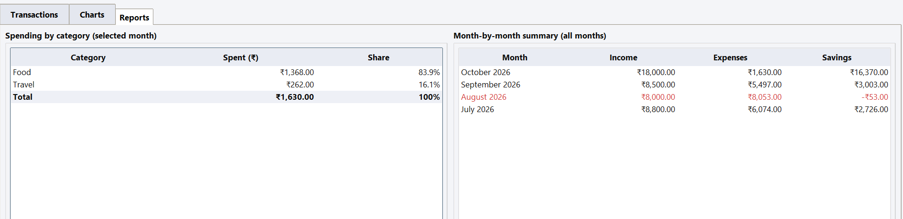
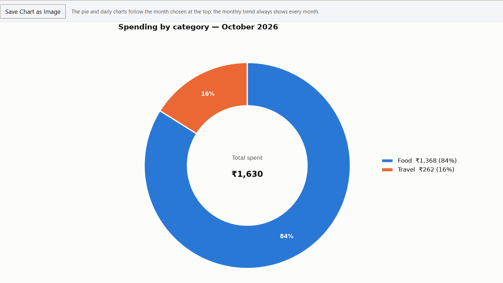

# Expense Tracker

A desktop application to record income and expenses, watch a monthly budget and see where the money goes. Built with **Python, Tkinter, Pandas and Matplotlib**. It works completely offline: no login, no internet connection, and all data stays on your own computer.

> Semester project, Department of Computer Applications, Shri Ram Murti Smarak International Business School, Lucknow (affiliated to Dr. A.P.J. Abdul Kalam Technical University).

## Screenshots





## Features

- Add, edit and delete income and expense transactions (amounts in ₹)
- Categories: Food, Travel, Shopping, Health, Other (income: Pocket Money, Salary, Other)
- Search and filter by date range, type or category
- Monthly summary and category-wise summary with income, expense and savings
- Monthly budget limit with a warning once 80% of it is spent
- Charts: spending by category (donut), monthly income vs expense (bars), daily spending (line), with a "save chart as image" option
- Export transactions to CSV or Excel
- Input validation with clear error messages (wrong date, negative amount, empty category and so on)
- Safe saving: data is written to a temporary file first, so it cannot be corrupted if the app closes mid-save
- 30 automated unit tests

## Tech stack

| Purpose | Tool |
|---|---|
| Language | Python 3 |
| Interface | Tkinter |
| Data handling | Pandas (DataFrame saved as CSV; budget saved as JSON) |
| Charts | Matplotlib (embedded in the Tkinter window) |
| Excel export | openpyxl |
| Testing | unittest |

## Project structure

```
expense_tracker/
├── main.py                  # starts the application
├── config.py                # paths, categories, currency, limits
├── validators.py            # checks every value before it is saved
├── storage.py               # loads and saves transactions and budget
├── analysis.py              # filters, totals, summaries, budget status
├── charts.py                # Matplotlib charts
├── reports.py               # CSV and Excel export
├── gui.py                   # Tkinter window (three tabs)
├── generate_sample_data.py  # optional demo data
├── requirements.txt
├── data/                    # expenses.csv and budget.json are kept here
└── tests/test_core.py       # unit tests
```

## How to run

1. Install Python 3.10 or newer (Tkinter comes with the standard Windows and macOS installers).
2. Download or clone this repository and open the folder in a terminal.
3. Install the libraries:

   ```
   pip install -r requirements.txt
   ```

4. *(Optional)* Fill the app with three months of demo data:

   ```
   python generate_sample_data.py
   ```

5. Start the app:

   ```
   python main.py
   ```

To start with your own data, delete the files inside the `data` folder.

## Run the tests

```
python -m unittest discover tests
```

## Design

The project was designed before coding using a use case diagram, a class diagram and an ER diagram (CATEGORY 1–N TRANSACTION, BUDGET 1–N TRANSACTION). Each module has one responsibility, so validation, storage, analysis, charts and the interface can be changed independently.

## Possible future work

- Recurring expenses
- Dark mode
- Web version

## Author

**Vinayak Gupta**
Guide: Mr. Anand Prakash
